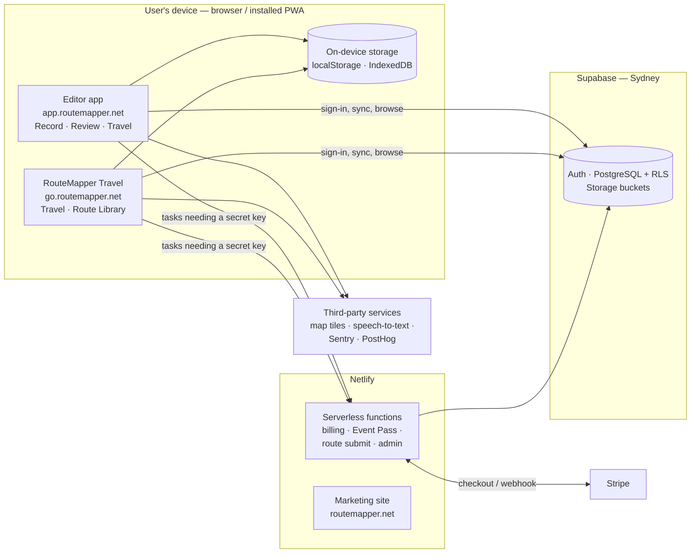
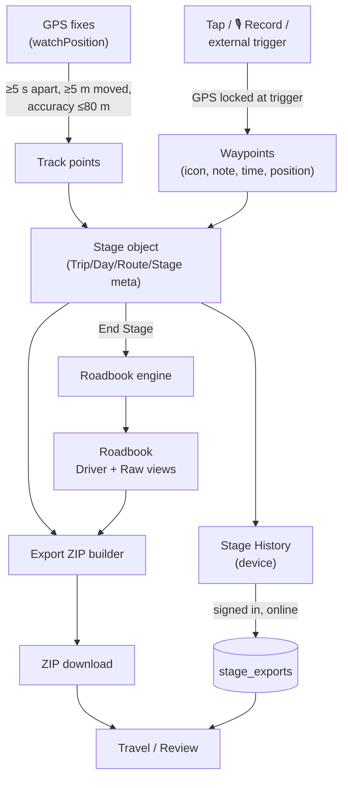
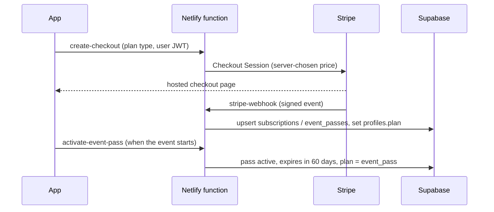

# RouteMapper Architecture — October 2026

| | |
|---|---|
| **Edition** | October 2026 |
| **Audience** | Technical readers: investor due diligence, partner integration teams, and future developers |
| **Scope** | The system as deployed on `main` in October 2026 |
| **Master copy** | GitHub `docs/architecture.md` |

Companion documents: [Specification](specification.md) (what the product does) · [Workflow](route-mapper-workflow.md) · design records for [Travel Mode](drive-mode-architecture.md), the [standalone Travel app](travel-standalone-app.md) and the [Route Library](route-library.md).

---

## 1. At a glance

RouteMapper is a browser-based product: a React single-page application, installable as a Progressive Web App, backed by Supabase (auth, PostgreSQL, file storage) and a small set of Netlify serverless functions for anything that needs a secret key (Stripe billing, Route Library publishing).

All route processing — GPS capture, roadbook generation, export packaging — runs **on the device**. The cloud stores and syncs results; it does not compute them. This is what lets the app work fully offline in the field.

## 2. Front ends

One repository builds **three** web properties, each its own Netlify project.

| Property | URL | Build | Purpose |
|---|---|---|---|
| **Editor** | app.routemapper.net | `vite.config.js` → `dist/` | Full product: Record (`/`), Review (`/review`), Travel (`/travel`; `/drive` redirects), auth (`/auth`, `/auth/reset`) |
| **RouteMapper Travel** | go.routemapper.net | `vite.travel.config.js` (root `apps/travel/`) | Thin installable reader (~450 kB JS vs ~2 MB editor); no sign-in for reading; Route Library at `/library` (lazy-loaded) |
| **Marketing site** | routemapper.net | static HTML in `website/` | Product pages, pricing, updates, legal |

Both apps share one `src/` tree. A shared `netlify.toml` serves both Netlify projects by parameterising the build command (`RM_BUILD_CMD`), with Node pinned to 22.

**Stack:** React 19, React Router 7, Vite 7, Tailwind CSS, `vite-plugin-pwa` (service worker, offline precache, OSM tile runtime cache), Leaflet / React-Leaflet for maps, JSZip, `docx` and jsPDF for export files.

### Source layout

| Path | Responsibility |
|---|---|
| `src/RouteMapperLayout.jsx` | Record mode: GPS, waypoint capture, stage lifecycle, controls (≈4,400 lines) |
| `src/roadbook/` | Roadbook engine — track preprocessing, turn detection, classification, waypoint merging, tulip rendering, HTML roadbook, GPX import. Shared by both apps |
| `src/export/` | Export package: ZIP assembly, per-tool exporters, map PDF, static map renderer |
| `src/review/` | Review mode |
| `src/travel/` | Travel mode: roadbook loader, GPS advance state machine, voice readout, live map, offline tile cache |
| `src/library/` | Route Library: browse, listing detail, submission, admin review |
| `src/voice/`, `src/speech/` | Push-to-talk capture, external trigger, command parser |
| `src/lib/` | Supabase client, stage history and sync, plan limits, Stripe checkout, Event Pass, analytics, Sentry, wake lock, storage-capacity and track-gap checks |
| `src/icons/` | Icon manifest (`iconManifest.json`, 38 icons) and SVGs — the single source of truth for icons |
| `src/services/device.js` | Platform abstraction (web vs Capacitor native) for GPS, files and sharing |
| `apps/travel/` | Entry point for the standalone Travel app |
| `netlify/functions/*.cjs` | Server functions (CommonJS required — see §11) |
| `website/` | Marketing site |
| `scripts/` | Developer utilities (roadbook regeneration, DOCX generation, trip combining, waypoint-speed analysis) |

## 3. Core data flow

### 3.1 Capture

- **Track:** `navigator.geolocation.watchPosition`, gated to one point per 5 s, minimum 5 m movement and maximum 80 m reported accuracy. A Wake Lock keeps the screen on; a gap detector warns at End Stage if the recorder was paused (iOS suspends background tabs).
- **Waypoints — snap-first:** position is captured at the trigger instant; the user then has a configurable 2–10 s window to refine icon/note before auto-commit. An optional *lookback offset* (up to 5 s) compensates for reaction time.
- **Voice — push-to-talk:** Web Speech API recognition (`en-AU`). The parser maps `[type] [icon] [— note]` phrases to icon IDs (aliases such as "danger two" → `danger_2`, "speed 60" → `speed_60`) and recognises *cancel/discard/abort*.
- **External trigger:** media keys (Bluetooth headset play/pause), Page Up/Down, Space and F8. To receive headset media keys on iOS, the app plays a short silent audio loop during recording so it holds the Now Playing media session.

### 3.2 Roadbook engine (`src/roadbook/`)

| Step | Module | Detail |
|---|---|---|
| Preprocess | `trackPreprocessor.js` | Simplify and de-noise the track |
| Detect turns | `turnDetection.js` | Heading change ≥ 25° → candidate event |
| Classify | `eventClassifier.js` | Left/right 90, bear, straight, etc. |
| Merge waypoints | `waypointMerger.js`, `lib/roadbook/snapWaypoints.js` | Snap manual waypoints onto the track (interpolated between bracketing track points) and merge with nearby detected turns; waypoint coordinates win |
| Score and filter | `roadbookFilter.js` | Confidence per event; **Driver view** keeps events ≥ 0.85 (strong derived turns ≥ 0.75) and clusters noise; **Raw view** keeps everything |
| Render tulips | `tulipRenderer.js` | SVG tulip from bearing in/out and angle; icons overlay (hazard/terrain/control) or badge (nav) |

The engine is deterministic and runs client-side. It is re-run at export time from track-snapped waypoints, so the printed roadbook, the GPX files and Review mode always agree. Travel mode also runs it on imported plain GPX tracks.

### 3.3 Export package (`src/export/buildRoutePackage.js`)

Builds one ZIP per stage — `Universal/`, `RallyNavigator/`, `Printable/`, `Source/`, `Garmin/`, `Hema/`, `Gaia/` plus `README.txt` (see Specification §6.7). GPX output follows OpenRally extensions (distance, CAP, tulip as base64 PNG) and is validated against Rally Navigator and Garmin BaseCamp. Map images for the PDF and roadbook header come from `staticMapRenderer.js`, a pure-canvas tile compositor with no map library dependency (also used for Route Library preview thumbnails).

### 3.4 Travel mode (`src/travel/`)

- **Loader** (`useRoadbook`, `lib/roadbookParse.js`): accepts export ZIP (including macOS re-zipped folders), `stage.json`, or GPX; optional DOCX text overlay (`lib/docxPatch.js`) replaces row notes from an edited Word roadbook.
- **Advance state machine** (`useTravelAdvance`): proximity trigger (default 30 m) plus a cumulative-distance fallback for waypoints offset from the driving line; manual override pauses auto-advance (default 30 s).
- **Distance** (`lib/alongTrack.js`): along-track to next row; straight-line with an *off-track* flag beyond 100 m.
- **Voice** (`useVoiceReadout`): `speechSynthesis`, announcing the upcoming row and the distance to it after a settle delay.
- **Map** (`RouteMap`, `TileLayer`): custom canvas/vector route map with optional raster backdrop, track-up rotation, pan/zoom.
- **Offline:** the last loaded stage persists in IndexedDB (`rm_travel`); route-corridor tiles can be pre-fetched (≈30-day retention); the PWA shell is precached.

## 4. Data storage

### 4.1 On the device

| Store | Keys / name | Contents |
|---|---|---|
| localStorage | `rm_stage:{owner}:{localId}` | Saved stages (Stage History; guests use this only) |
| localStorage | autosave slot | The active stage draft (shared between Record and Review) |
| localStorage | `rm_pending_queue_v1` | Stages waiting to upload |
| localStorage | `rm_*` settings | Snap windows, silence timeout, lookback, DOCX map option, Travel settings |
| IndexedDB | `rm_travel` | Last stage loaded into Travel; offline map tiles |

A storage-capacity check warns before the browser's quota is reached.

### 4.2 In the cloud — Supabase PostgreSQL (project `rfmvyachiypzvtxpdvma`, Sydney)

Row-level security is enabled on every table.

| Table | Purpose |
|---|---|
| `profiles` | One row per user: name, organisation, phone, email, `plan`, Stripe customer ID, marketing-subscription flag |
| `stage_exports` | Synced stages — `meta` and full `payload` as JSONB, unique on (`user_id`, `local_id`) |
| `subscriptions` | Stripe subscription mirror: plan, status, period end |
| `event_passes` | Event Pass lifecycle: `unused` → `active` (60 days from activation) → expired |
| `beta_users` | Beta cohort management (status, cohort, notes) |
| `route_authors` | Approved Route Library authors; `is_admin` flag for curation |
| `route_listings` | Library listings: status (`draft` → `submitted` → `in_review` → `published`/`rejected`/`unpublished`), metadata, bounding box, price, ratings, generated full-text search vector |
| `route_versions` | Versioned route files (storage path, format version, derived metadata) |
| `route_downloads` | Download log |
| `sections`, `waypoints` | **Legacy** tables from the 2025 versions; no longer written to. Candidates for removal |

**Storage buckets:** `route-files` (Library route ZIPs — public-read during the free phase, to become private with signed URLs when paid routes launch) and `route-previews` (listing thumbnails).

### 4.3 Sync model

Recording is local-first. On End Stage the stage is written to Stage History on the device, then upserted to `stage_exports` if the user is signed in and online; otherwise it is queued and flushed when connectivity returns. Review-mode edits to cloud stages write to both copies. Deleting from History removes the stage from device and cloud.

## 5. Identity and access

- **Supabase Auth**, email and password, with password reset by email.
- **Guest mode** is a client-side state: full functionality, no cloud access.
- **Plan limits** (`src/lib/planLimits.js`) are enforced in the client: Free = 1 saved stage, 20 waypoints per stage, core GPX only; Solo, Pro and Event Pass = unlimited with the full export package.
- **Route Library authorship** requires an active `route_authors` row; authors can only create `draft`/`submitted` listings. Publishing is an admin action performed server-side.

## 6. Billing

- Prices are chosen on the server from the plan type, never taken from the client.
- The webhook is signature-verified and idempotent.
- `profiles.plan`, `stripe_customer_id` and `event_passes` are **column-locked** against client writes (August 2026 fix; recorded in `db/security/2026-08-31-lock-billing-columns.sql`). Only the service role can change billing state.
- Customers manage cards, invoices and cancellation through the Stripe Billing Portal (`create-portal-session`).
- Stripe Tax handles Australian GST.

## 7. Route Library

- **Read path:** anonymous reads of published listings with faceted and full-text search (Postgres `tsvector`); one-tap "Open in Travel" hands the file to Travel mode on the same origin.
- **Submission path:** the browser sends the file and metadata to `submit-route`, which validates the roadbook with the same parser Travel uses, derives metadata (distance, waypoint and stage counts, bounding box), uploads to storage and creates a `submitted` listing. Server-side upload is required because browser uploads to the bucket are rejected by the storage service.
- **Curation:** `admin-listings` (admin-only) lists the queue and publishes, rejects or unpublishes.
- **Planned (Phase B–D):** paid checkout, private bucket with signed URLs, purchase entitlements, payout ledger, Stripe Connect for automatic 60/40 payouts, reviews, and radius ("near me") search via PostGIS. See [route-library.md](route-library.md).

## 8. Maps

| Where | Library | Tile sources |
|---|---|---|
| Record, Review | Leaflet | OpenStreetMap (default), OpenTopoMap, Esri World Imagery; Mapbox Satellite HD in Review when a token is configured |
| Travel | Custom canvas map | Esri/ArcGIS World Imagery via ArcGIS Location Platform (licensed key), OpenStreetMap, OpenTopoMap, or vector-only |
| PDF, roadbook header, Library thumbnails | `staticMapRenderer.js` (canvas) | ArcGIS static basemap / imagery, OSM, OpenTopoMap |

Mapbox and ArcGIS keys are supplied as build-time environment variables (`VITE_MAPBOX_TOKEN`, `VITE_ARCGIS_API_KEY`); features degrade gracefully when absent.

## 9. Hosting, deployment and workflow

- **Netlify** hosts all three properties and the functions. DNS for `routemapper.net` is on Netlify.
- **Branching:** `main` is production and protected. Work happens on `feature/*`, `fix/*` or `hotfix/*` branches, merged by pull request. Every pull request gets a Netlify preview URL, which is the staging step. See [DEVELOPMENT.md](../DEVELOPMENT.md).
- **Build stamp:** the commit SHA is embedded in each build so the bundle served to a device can be identified.

## 10. Observability

- **Sentry** — error reporting with a React error boundary.
- **PostHog** (EU host) — product-usage funnel analytics.
- **In-app diagnostics** — an iOS lifecycle log and diagnostic log in Record; a diagnostics overlay in Travel showing GPS accuracy, track offset and auto-advance state.

## 11. Security summary

| Area | Control |
|---|---|
| Data isolation | RLS on every table; users see only their own stages and passes |
| Billing integrity | Server-side price selection, signed webhook, column-level locks on billing fields |
| Secrets | Stripe secret, webhook secret and Supabase service key exist only in Netlify function environment variables |
| Payments | Card data handled solely by Stripe (no card data touches RouteMapper systems) |
| Library content | Mandatory review before publishing; authors cannot self-publish |
| Transport | HTTPS everywhere (Let's Encrypt via Netlify); local dev also uses HTTPS because geolocation and speech require a secure context |

## 12. Native iOS (paused)

A Capacitor 8 build was brought to a working state in January 2026 (native geolocation, filesystem, share sheet, haptics, keep-awake). It was paused because `@capacitor-community/speech-recognition` does not support Swift Package Manager, which Capacitor 8 uses by default. The Capacitor dependencies and the platform abstraction in `src/services/device.js` remain in the codebase, so the native build can be resumed without reworking the app. The `ios/` project folder is not currently in this repository.

## 13. Known technical debt and risks

| Item | Impact | Note |
|---|---|---|
| Production schema is not under migration control | Changes are applied directly; SQL files in `docs/` and `db/` are records, not migrations | Adopt Supabase CLI migrations |
| No automated test suite | Regressions caught by manual testing on PR previews | Highest-value target: the roadbook engine and Travel advance logic |
| `RouteMapperLayout.jsx` ≈4,400 lines | Hard to change safely | Extract GPS, capture and stage lifecycle into hooks |
| Editor bundle ≈2 MB in one chunk | Slower first load on poor connections | Travel and Review are already lazy-loaded |
| Legacy tables (`sections`, `waypoints`) and files (`ReplayRoute.jsx`, `replay_route.jsx`, Google Maps dependency, `tulipRederer.js`) | Clutter | Safe to remove after confirmation |
| Library `download_count` not incremented | Metric gap | Needs a small RPC or function |
| Sign-in screen text still says "private beta" | Inconsistent with public launch | Copy change |
